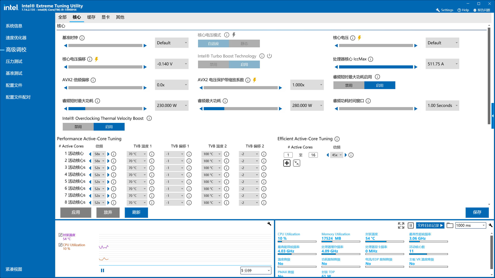
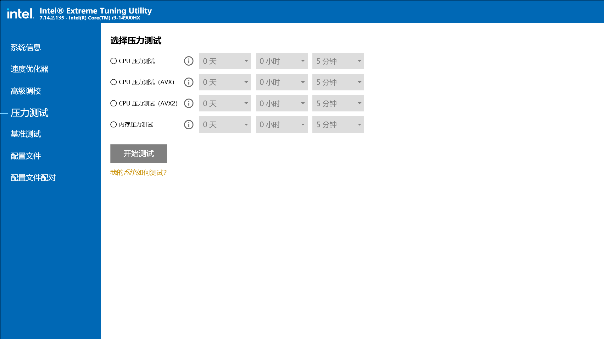
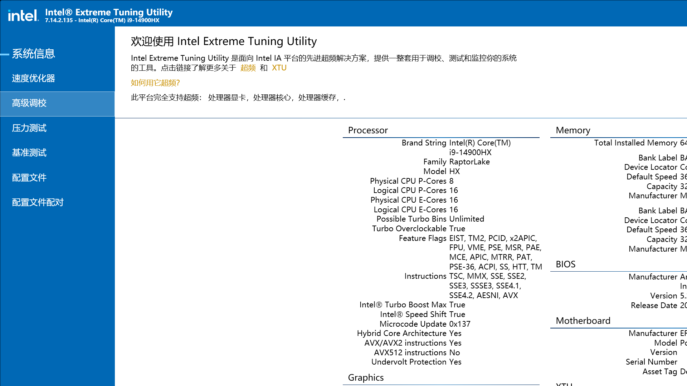
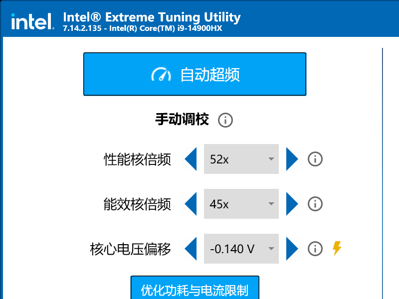
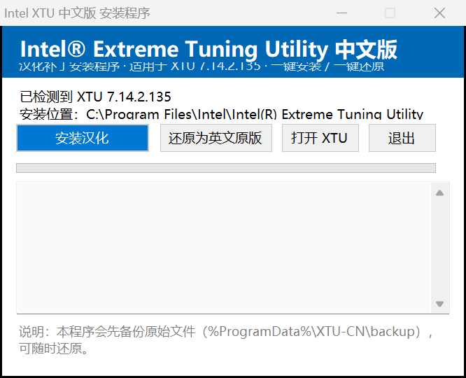

# XTU Chinese Localization Toolkit (xtu-chinese)

[中文说明](README.md) ・ **English**

Open-source toolkit that localizes **Intel® Extreme Tuning Utility (XTU)** into Simplified Chinese,
plus a one-click installer that can bundle the official Intel setup.



| Stress test | System info | Compact view | Installer |
|---|---|---|---|
|  |  |  |  |

> Targets **XTU 7.14.2.135 (x64)**. The repository ships **no Intel binaries** — every patch is
> generated against an XTU installation already present on your machine.

## What it does

XTU is a WPF / .NET Framework app whose UI text lives in four different places. This project
patches all of them and writes the result back with Mono.Cecil:

| Carrier | Tool | Approx. strings |
|---|---|---|
| 105 BAML resources (compiled XAML) | `src/tools/XtuBaml.cs` | 409 occurrences / 317 unique |
| Embedded theme XAML (`*ColorTheme.xaml`) | `src/scripts/patch_themes.py` | 46 |
| `KnobMetadata.xml` / `MonitorMetadata.xml` inside `IntelOverclockingSDK.dll` | `src/scripts/build_maps.py` | 432 |
| `ldstr` literals in `PerfTune.exe` / `XtuCommon.dll` / `XtuCoreClient.dll` / `PerfTuneCommon.dll` | `src/tools/XtuPatch.cs` | ~900 |

XTU validates the Authenticode signature of a list of DLLs on startup via
`Intel.Overclocking.SDK.SoftwareTrustVerification.SoftwareTrustVerification.CreateLogFile()`.
The tool rewrites that method to `return true` (one single change), otherwise modified DLLs are
refused with *"XTU signature validation failed"*.

Details: [docs/技术原理.md](docs/技术原理.md) (Chinese).

## Build

Requirements: Windows 10/11 x64, XTU 7.14.2.135 installed, .NET Framework 4.8, Python 3.

```powershell
.\build.ps1 -Stage tools      # compile the C# helpers (downloads Mono.Cecil once)
.\build.ps1 -Stage extract    # pull BAML / XML / theme XAML out of the installed XTU
.\build.ps1 -Stage generate   # build the patch maps from translations/
.\build.ps1 -Stage patch      # apply to the install dir (original files are backed up)
.\build.ps1 -Stage installer  # produce dist\XTU-CN-Setup.exe
.\build.ps1 -Stage restore    # roll back to the English original
```

`-Stage installer` embeds `vendor\XTUSetup_7.14.2.135.exe` when present, so the installer can
also set XTU up from scratch. Drop the official setup there (it is git-ignored) or build a
patch-only installer without it.

## Repository layout

```
src/tools/        BAML reader/writer, assembly rewriter, IL dumper (C#)
src/installer/    WinForms installer (C#)
src/scripts/      extraction, candidate selection, patch pipeline (Python / PowerShell)
translations/     glossary + source strings + translations (TSV)
docs/             internals, workflow, known issues
screenshots/      UI captures
```

## Status / known gaps

The following remain English on purpose or because no plain-text source exists:

- System-information field names (`Brand String`, `Family`, …) — provided at runtime by the
  service-side `Drivers\HardwareAccess.dll`
- One paragraph at the top of the Benchmark page — no plain-text source found in the install tree
- `Benchmark` / `Score` column headers and the `Default` / `Active` profile names
- The help file `XTU_help.chm`
- Perf-counter monitor names in `Xtu3ServiceLayer.dll` (tied to Windows counter keys)

See [docs/已知问题.md](docs/已知问题.md).

## Contributing

Translations are plain TSV files (`id<TAB>Chinese`). Edit `translations/tr_*.tsv`, then run
`build.ps1 -Stage generate -Stage patch` to verify. Follow
[translations/GLOSSARY.md](translations/GLOSSARY.md).

## Disclaimer

- Personal, educational localization project; **no Intel binaries are distributed here**
- Modified files lose their Intel signature and may trigger SmartScreen
- Intel and XTU are trademarks of Intel Corporation
- Use at your own risk

## License

[GPL-3.0](LICENSE). Derivative works must be released under the same license when distributed.
