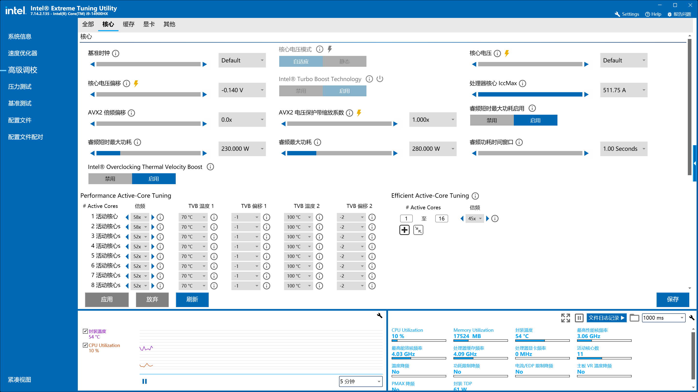
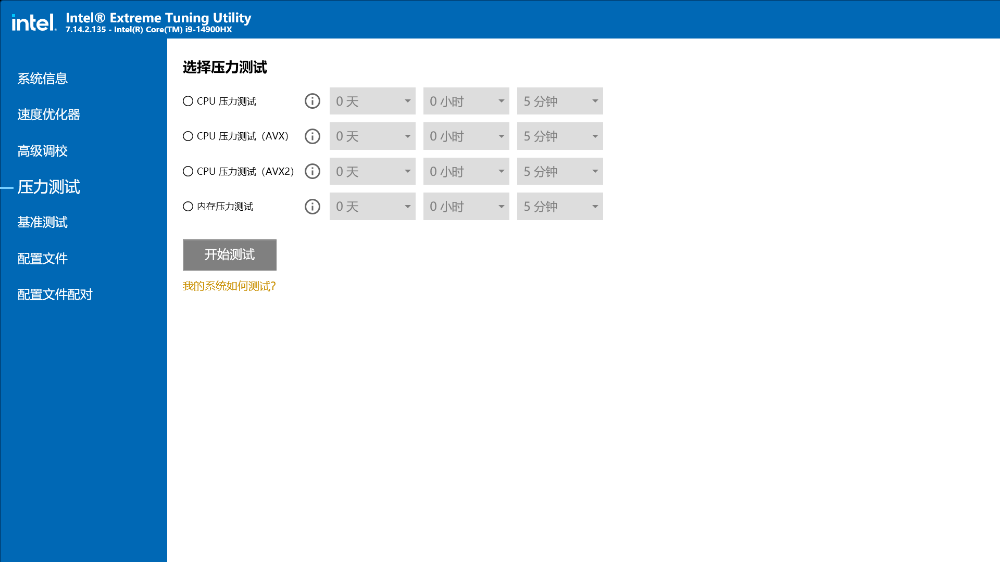
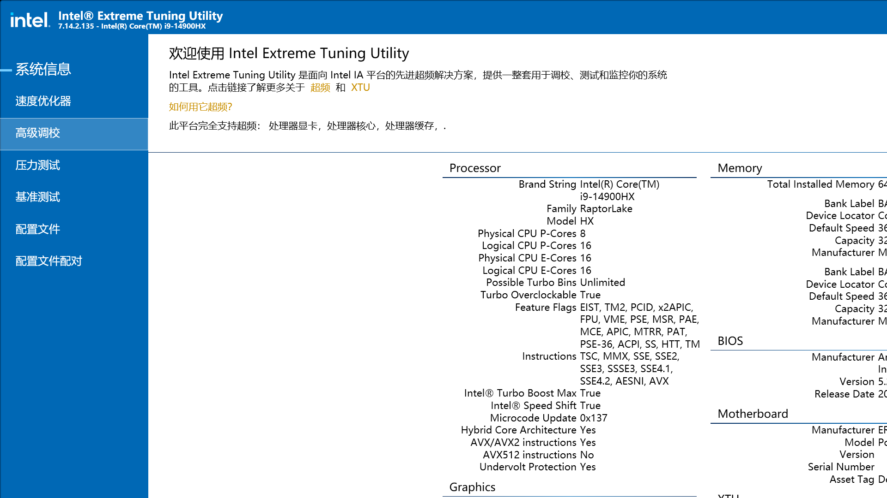
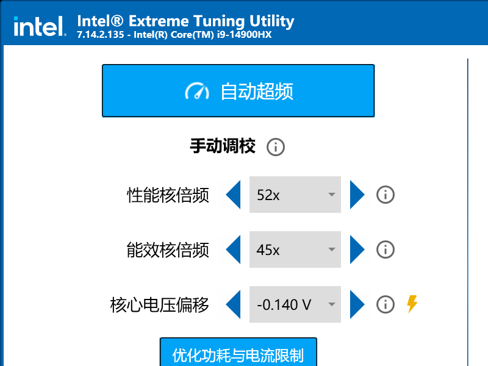
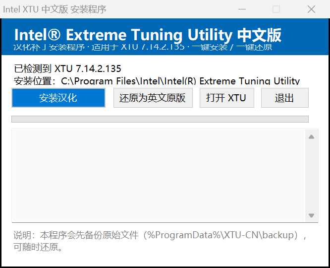

# XTU 中文化工具（xtu-chinese）

把 Intel® Extreme Tuning Utility（XTU）界面汉化为简体中文的开源工具链与翻译数据。

> 适用于 **XTU 7.14.2.135（64 位）**。项目本身**不包含任何 Intel 版权文件**，
> 所有补丁都在本机已安装的 XTU 上生成。



| 压力测试 | 系统信息 | 紧凑视图 | 安装包 |
|---|---|---|---|
|  |  |  |  |

## 特性

- **完整汉化**：105 个界面 BAML、内嵌主题 XAML、选项卡配置、调参项元数据、监控项元数据、程序内提示与日志，约 1900 条文案
- **可逆**：安装时备份原文件，一键还原英文原版
- **可离线分发**：附带打包脚本，生成单文件安装程序（可内含官方安装包，实现"一键装好即中文"）
- **翻译可维护**：全部译文以 TSV 形式存放在 `translations/`，可自行修改、增量重打包

## 目录结构

```
src/tools/         BAML 读写、程序集改写、IL 反汇编（C#）
src/installer/     安装包程序（WinForms，C#）
src/scripts/       资源提取、翻译表生成、补丁流水线（Python / PowerShell）
translations/      术语表 + 源文案 + 译文（TSV）
docs/              原理、流程与已知问题
screenshots/       效果截图
```

## 快速开始

前置条件：

- Windows 10/11 x64
- 已安装 **XTU 7.14.2.135**（默认路径 `C:\Program Files\Intel\Intel(R) Extreme Tuning Utility`）
- .NET Framework 4.8（系统自带）
- Python 3（生成补丁表用）

```powershell
# 1) 提取 XTU 内嵌资源（BAML / XML / 主题 XAML）
powershell -ExecutionPolicy Bypass -File .\build.ps1 -Stage extract

# 2) 生成补丁并写入安装目录（会先备份到 C:\ProgramData\XTU-CN\backup）
powershell -ExecutionPolicy Bypass -File .\build.ps1 -Stage patch

# 3) 打包成单文件安装程序（需要 vendor\XTUSetup_7.14.2.135.exe）
powershell -ExecutionPolicy Bypass -File .\build.ps1 -Stage installer
```

还原英文：运行安装程序选择"还原为英文原版"，或执行
`powershell -ExecutionPolicy Bypass -File .\build.ps1 -Stage restore`。

## 原理概要

XTU 是 WPF/.NET 应用，界面与文案分布在四个位置，工具分别处理：

1. **BAML（编译后的 XAML）**：用 WPF 内部的 `MS.Internal.Globalization` 语法树 API 读出节点、
   替换文本、再序列化回 BAML（`src/tools/XtuBaml.cs`）。
2. **内嵌主题 XAML**：页面大段说明文字在 `PerfTune.Initialization.*ColorTheme.xaml` 里，
   以 `Value="..."` 形式存在，按文本替换（`src/scripts/patch_themes.py`）。
3. **服务端元数据 XML**：调参项/监控项名称与说明在 `IntelOverclockingSDK.dll` 的内嵌
   `KnobMetadata.xml` / `MonitorMetadata.xml`（`src/scripts/build_maps.py`）。
4. **程序字符串常量**：用 Mono.Cecil 重写程序集里的 `ldstr` 字面量，并替换内嵌资源
   （`src/tools/XtuPatch.cs`）。

另外，XTU 启动时会调用
`Intel.Overclocking.SDK.SoftwareTrustVerification.SoftwareTrustVerification.CreateLogFile()`
校验安装目录下 DLL 的 Intel 数字签名，任何被修改的文件都会弹窗拒绝启动。
工具把该方法改写为直接返回 `true`（仅此一处），否则汉化文件无法加载。

细节见 [docs/技术原理.md](docs/技术原理.md)。

## 已知未汉化项

- 系统信息表格字段名（Brand String / Family / Model…）：由后台服务
  `Drivers\HardwareAccess.dll` 运行时提供
- 基准测试页顶部一段概述：安装目录中未找到明文来源
- 配置文件列表的 `Benchmark` / `Score` 列名与配置名 `Default` / `Active`
- 帮助文档 `XTU_help.chm`（英文）

## 贡献

欢迎提 PR 改进译文：译文都是 `translations/tr_*.tsv`（`id<TAB>中文`），
修改后重新执行 `build.ps1 -Stage patch` 即可验证效果。术语请遵循
[translations/GLOSSARY.md](translations/GLOSSARY.md)。

## 免责声明

- 本项目仅用于个人学习与界面本地化，**不提供任何 Intel 二进制文件**
- 修改后的程序不具备 Intel 数字签名，可能被 SmartScreen 提示
- 使用本工具产生的任何后果（含保修、稳定性）由使用者自行承担
- Intel、XTU 等商标归 Intel Corporation 所有

## License

[MIT](LICENSE)
